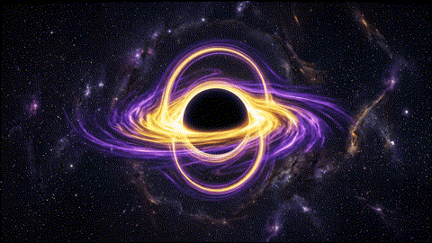

  

<h1 align="center">mrdavcompile</h1>

  <em>Dynamical systems · Optimization · Reconfigurable hardware</em> 
  <em>Sistemas dinâmicos · Otimização · Hardware reconfigurável</em>

  <a href="#-português">🇧🇷 Português</a> &nbsp;|&nbsp; <a href="#-english">🇺🇸 English</a>

  
  
  

---

## 🇧🇷 Português

<b>Clique para recolher / expandir</b>

### 🌌 Sobre

Estudante de Ciência da Computação com base em **processos estocásticos**,
**otimização convexa** e **dinâmica não linear**. Neste perfil testo scripts de
pesquisa diariamente: simulações, protótipos e experimentos ainda em fase de bancada.

$$\dot{x} = f(x,\mu)$$

### 🔬 Linhas de pesquisa

| Área | O que explora |
|------|---------------|
| **Dinâmica não linear** | Atratores, bifurcações, estabilidade |
| **Neurônios excitáveis** | Modelos de disparo implementados em hardware |
| **FPGA / Verilog** | Síntese digital de sistemas dinâmicos |
| **Otimização convexa** | Formulação e resolução de problemas |
| **Processos estocásticos** | Modelagem e simulação de sistemas com ruído |

---

## 🇺🇸 English

<b>Click to collapse / expand</b>

### 🌌 About

Computer Science student with a research background in **stochastic processes**,
**convex optimization** and **nonlinear dynamics**. On this profile I test
research scripts daily: simulations, prototypes and experiments still at the bench stage.

$$\dot{x} = f(x,\mu)$$

### 🔬 Research areas

| Area | What I explore |
|------|----------------|
| **Nonlinear dynamics** | Attractors, bifurcations, stability |
| **Excitable neurons** | Spiking models implemented in hardware |
| **FPGA / Verilog** | Digital synthesis of dynamical systems |
| **Convex optimization** | Problem formulation and solving |
| **Stochastic processes** | Modeling and simulation of noisy systems |

---

## 🧪 Stack

  
  
  
  
  
  

## 📈 Activity · Atividade

  
  

## 📫 Contact · Contato

...

"Tudo converge para algum atrator." · "Everything converges to some attractor." 🕳️

